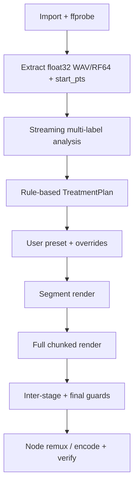

# Audio Pipeline — AudioRestorer AI

**Status:** Approved planning document  
**Related:** [AI_MODEL_EVALUATION.md](AI_MODEL_EVALUATION.md), [API_SPECIFICATION.md](API_SPECIFICATION.md), [TESTING_STRATEGY.md](TESTING_STRATEGY.md)

---

## 1. Design principles

1. **Original audio is immutable.** All processing writes derived artifacts.
2. **Content-aware routing.** Never apply speech enhancement blindly to music.
3. **Restoration ≠ reconstruction.** Label generative bandwidth fill explicitly.
4. **Length and sync preservation.** Sample count in == sample count out (per stream); compensate algorithmic latency.
5. **Do-no-harm.** Clean or mildly degraded audio must not be damaged; quality guards can skip stages.
6. **Streaming first.** Multi-hour files use chunked I/O and RF64; no full-file float arrays.
7. **Transparent planning.** MVP planner is rule-based and unit-testable.

---

## 2. End-to-end flow



---

## 3. Media extraction and interchange

### 3.1 Extraction (Node / FFmpeg)

- Select user-chosen audio stream (default: disposition default).
- Decode to **PCM float32**, interleaved or planar WAV/RF64.
- Prefer **native sample rate** for analysis; engine may resample to **48 kHz** working rate for the processing graph.
- Record: `start_pts`, `duration_samples`, `sample_rate`, `channels`, `channel_layout`, codec tags.
- Do **not** rely on `-shortest`.

### 3.2 Working format

| Property | Value |
|----------|-------|
| Sample format | float32 |
| Working rate | 48 kHz (adapters may require other rates internally) |
| Container for temps | WAV or RF64 when &gt; 4 GB |
| Chunking | ~10 s with overlap; model-specific (Demucs ≤ 7.8 s) |
| Crossfade | Raised-cosine OLA |

### 3.3 Latency compensation

Every stage declares `latency_samples`. The orchestrator trims/pads so stage output length equals stage input length before the next stage.

---

## 4. AI audio analyzer

### 4.1 Goals

Produce a versioned `AnalysisResult` with:

- Global metrics
- Timeline regions (content probabilities)
- Issue list (severity, confidence, evidence, recoverability)
- Analyzer / model versions

### 4.2 Signal features

| Feature | Use | Limitation |
|---------|-----|------------|
| RMS | Level, dynamics context | Not loudness-calibrated |
| Peak / sample peak | Headroom | Misses inter-sample peaks |
| True peak | Limiting / export compliance | Needs oversampling; use ebur128 |
| LUFS (I/S/M), LRA | Loudness diagnosis | Level ≠ quality |
| Crest factor | Dynamics / possible over-compression | Low crest can be intentional mastering |
| Spectral centroid | Brightness / muffling proxy | Bass-heavy music skews low |
| Spectral rolloff | HF presence | Genre-dependent |
| Spectral flatness | Noise-like vs tonal | Cymbals look noise-like |
| Spectral bandwidth | Spread of energy | Ambiguous alone |
| FFT / STFT | Base for detectors | Window/hop bias |
| Band energies / LTAS | Muffling, hiss floor | Needs content-conditional reference |
| Stereo correlation | Width / phase | Reverb lowers correlation |
| L/R balance | Imbalance | Creative panning |
| Histogram near full-scale | Soft/hard clip detection | Encoded peaks may sit below 0 dBFS |

**Authoritative loudness:** FFmpeg `ebur128=peak=true` (streaming). Cross-check with pyloudnorm for engine-side adjustments.

### 4.3 Content classification

1. **Silero VAD** → speech activity timeline.  
2. **Tagger** (PANNs/EfficientAT) → speech / music / crowd / wind / other tags on ~1 s hop.  
3. Fuse into region labels: `speech_dominant`, `music_dominant`, `mixed`, `ambience`.

Hysteresis and minimum region duration avoid rapid toggling that would click when gating enhancement.

### 4.4 Degradation detectors

| Detector | Method (summary) | Recoverability notes |
|----------|------------------|----------------------|
| Clipping | Runs at digital max + near-peak histogram mass; detect pre-encode clip | Partial |
| Distortion | Harmonic oddities / high error vs linear prediction in peaks | Partial / not_recoverable |
| Hum | Stationary narrow peaks at 50/60 Hz + harmonics | Recoverable (notch) |
| Hiss | HF floor in quietest frames | Partial (denoise tradeoffs) |
| Wind | Non-stationary LF bursts, low LF inter-channel coherence | Partial |
| Muffled / freq suppression | HF tilt vs content-conditional LTAS, gated by noise floor | Partial (SNR-limited) |
| Background noise | Residual after content model / flatness in pauses | Partial |
| Stereo imbalance | L/R RMS delta, correlation, polarity | Recoverable if gain/polarity |
| Dynamic range issues | Crest + LRA vs targets | Context-dependent |
| Loudness issues | Integrated LUFS vs targets | Recoverable (normalize) |

### 4.5 Normalized analysis schema (conceptual)

```json
{
  "schema_version": "1.0.0",
  "media_id": "uuid",
  "duration_sec": 0,
  "sample_rate": 48000,
  "channels": 2,
  "global_metrics": {
    "loudness": { "integrated_lufs": -18.2, "lra": 9.1, "true_peak_dbtp": -1.2 },
    "crest_factor_db": 12.4,
    "stereo": { "correlation": 0.72, "lr_balance_db": 1.1 }
  },
  "timeline": [
    {
      "start_sec": 0.0,
      "end_sec": 1.0,
      "content": { "speech": 0.82, "music": 0.15, "ambience": 0.03 },
      "label": "speech_dominant"
    }
  ],
  "issues": [
    {
      "id": "hum",
      "severity": 0.7,
      "confidence": 0.85,
      "recoverability": "recoverable",
      "evidence": { "f0_hz": 60, "harmonics": [60, 120, 180] },
      "regions": [{ "start_sec": 0, "end_sec": 120 }]
    }
  ],
  "versions": { "analyzer": "0.1.0", "vad": "silero-6.3", "tagger": "panns-cnn14" }
}
```

Full TypeScript/Pydantic definitions live in [API_SPECIFICATION.md](API_SPECIFICATION.md).

---

## 5. Adaptive treatment engine

### 5.1 Planner contract

```
plan(analysis, preset, overrides) -> TreatmentPlan
```

Pure function for MVP. Unit-testable without audio I/O.

### 5.2 Presets

| Preset | Character |
|--------|-----------|
| **Natural** | Minimal intervention; prefer skip when confidence mid; low attenuation limits |
| **Balanced** | Default recommendations |
| **Enhanced** | Stronger denoise / EQ / dynamics within safe bounds |

### 5.3 Example routing rules

| Condition | Action |
|-----------|--------|
| Speech-dominant + noise (conf ≥ 0.6) | Enable DeepFilterNet on speech regions with attenuation limit |
| Music-dominant + muffled | Music-safe EQ / spectral restoration; **no** speech enhancer |
| Music-dominant + suppressed music | Investigate separation remix (**V2**); else EQ only |
| Clipping conf ≥ threshold | Declip before filters |
| Wind | LF HPF + wind-oriented dynamics; careful with kick/bass music |
| Hum | Notch comb at detected f0 + harmonics |
| Hiss + music | Gentle spectral gate only if hiss detector fires |
| Hiss + speech | Prefer speech enhancer over aggressive gate |
| Stereo imbalance | Channel gain / polarity / mild width |
| Loudness / DR issues | Expand or compress as appropriate **after** denoise; loudness + limiter last |

Confidence bands:

- ≥ 0.6 → enable by default  
- 0.4–0.6 → suggest (UI toggle default off or soft)  
- &lt; 0.4 → record but do not enable  

### 5.4 Dependencies, order, conflicts

**Canonical stage order** (skip unless enabled):

1. Input conditioning (DC block, resample, channel layout)  
2. **Declip** (before filtering — preserves clip cues)  
3. **Hum notch comb** (before denoise — avoid absorbing tones into noise estimate)  
4. Wind / rumble (HPF / LF control)  
5. **Denoise** (speech: DeepFilterNet gated; music: spectral gate if hiss)  
6. Dereverb **[V2]**  
7. Separation / remix **[V2]**  
8. Tonal EQ (muffling compensation after denoise)  
9. Stereo correction  
10. Dynamics (expander / multiband compressor)  
11. De-ess (speech only)  
12. Loudness normalization  
13. True-peak limiter (always last when loudness enabled)

**Conflicts:**

| Conflict | Resolution |
|----------|------------|
| HF boost vs hiss | Cap boost per band by measured band SNR |
| Compression raises noise floor | Denoise first; use expander; limit ratio |
| Speech FX on mixed content | VAD-gated with crossfades + hysteresis; attenuation limit preserves ambience |
| Wind HPF vs music bass | Content-aware cutoff; lower strength on music_dominant |
| Multiple denoisers | Mutually exclusive per region; planner picks one |

**Fallback:** On guard failure → retry milder params → skip stage → warn user → continue.

**User override:** Applied last; recorded in `RestorationSettings` snapshot for reproducibility.

---

## 6. DSP restoration engine

### 6.1 Modules

| Module | Implementation notes |
|--------|----------------------|
| Parametric EQ | SciPy SOS peaking/shelving |
| HPF / LPF | Butterworth/elliptical SOS |
| Notch comb | Cascaded notches at f0·n |
| Multiband compression | Pedalboard or custom; 3–4 bands |
| Expander | Gate noise floor after denoise |
| Limiter | True-peak aware; ceiling −1 dBTP default |
| Stereo | Balance, mid/side width, polarity |
| Loudness normalize | Toward target LUFS with true-peak constraint |
| De-esser | Speech-only dynamic EQ ~4–10 kHz |
| Spectral gate | Music hiss; conservative |
| Declipper | Janssen-style AR for short runs (MVP) |

### 6.2 Safe parameter boundaries (initial; calibrate in Phase 0–2)

| Parameter | Bound |
|-----------|-------|
| EQ boost per band | ≤ +9 dB |
| Total HF shelf | ≤ +12 dB |
| EQ cut | ≤ −18 dB |
| Notch Q | 20–60 |
| Max hum harmonics | 10 |
| DeepFilterNet atten limit | Natural 6 / Balanced 12 / Enhanced 18 dB |
| Spectral gate reduction | ≤ 12 dB (music) |
| Compressor ratio | ≤ 4:1 (multiband) |
| Limiter ceiling | −1.0 dBTP |
| Loudness targets | −23 / **−16** (default) / −14 LUFS |
| Stereo width | 0.5–1.5 (1.0 = unchanged) |
| HPF wind (speech) | up to ~120 Hz; music much lower / milder |

### 6.3 AI-controlled vs user-exposed

**AI / analyzer sets (detection-driven):**

- Notch frequencies and harmonic counts  
- Noise / hiss profiles  
- EQ curve *shape* from muffling estimate  
- Clip threshold / clipped sample mask  
- Crossovers, VAD gate masks  

**Users get macros** (scaled into safe bounds):

- Restoration strength  
- Music enhancement  
- Speech clarity  
- Ambience preservation  
- Noise reduction  
- Bass balance  
- Treble recovery  
- Stereo width  
- Loudness target  

Advanced panel: per-module enable + numeric fine control.

### 6.4 Preset mapping (illustrative)

| Control | Natural | Balanced | Enhanced |
|---------|---------|----------|----------|
| Strength | 0.35 | 0.6 | 0.85 |
| Noise reduction | Low | Medium | High |
| Treble recovery | Mild | Medium | Strong (SNR-capped) |
| Ambience preservation | High | Medium | Lower |
| Atten limit (DFN) | 6 dB | 12 dB | 18 dB |

---

## 7. Quality validation

### 7.1 Inter-stage guards

After each enabled stage, check:

- Loudness delta within expected band for that stage  
- No new clipping (or within limiter plan)  
- Residual-energy ratio sane for denoise  
- Spectral distance not pathological  
- Musical-noise / pumping heuristics for denoise + dynamics  

Failure → milder retry → skip + `warnings[]`.

### 7.2 Final validation

- Sample count match  
- True peak ≤ ceiling + tolerance  
- Integrated LUFS within ±0.5 LU of target (if normalize on)  
- Optional DNSMOS sampling on speech regions only  
- Do-no-harm path: near-identity on clean fixtures  

### 7.3 Metrics that must not be misused

- **PESQ / STOI / DNSMOS** — speech scenarios only; never primary music quality.  
- **SI-SDR** — when a reference exists (synthetic); not for blind real-world music.  
- Listening tests required for product acceptance.

---

## 8. Video and audio handling rules

### 8.1 Containers

MP4, MOV, MKV, AVI, WAV, MP3, AAC/M4A, FLAC — see PRD.

### 8.2 Remux policy

- Map video (and optional subs/attachments) with `-c copy`.  
- Replace selected audio with restored stream.  
- `-map_metadata 0 -map_chapters 0`.  
- Restore original audio `start_time` / PTS offset.  
- **Never** use `-shortest` as a sync strategy.  
- Verify with ffprobe + decoded sample count.

### 8.3 Encode defaults

| Target | Codec |
|--------|-------|
| MP4/M4A audio | Native FFmpeg AAC ≥ 256 kbps (no libfdk) or ALAC |
| MOV | PCM or AAC |
| MKV | FLAC / PCM / Opus |
| AVI | Discourage; suggest MKV |
| Audio-only | WAV, FLAC, MP3 (LAME), M4A |

### 8.4 Edge cases

| Case | Handling |
|------|----------|
| VFR video | Stream-copy video; do not re-encode by default |
| Multiple audio | User selects; others copied unchanged |
| Multichannel | MVP: downmix to stereo for processing or process first two channels with warning; full 5.1 = V2 |
| Long files | RF64 + chunk streaming; disk preflight |
| Corruption | Compare expected vs decoded samples; refuse/warn |
| Interrupted job | Resume from last stage artifact |

### 8.5 Preview proxies

- Low-res H.264 video proxy for Chromium playback.  
- Original + restored audio segments as WAV/Opus for A/B.  
- Loudness-match A/B by default.

---

## 9. GPU and chunking notes

- One GPU worker; sequential heavy models.  
- Lazy load / unload; VRAM budget on RTX 3070 8 GB.  
- Overlap-add reconstruction mandatory for chunked nets.  
- CPU fallback path for every MVP adapter.  
- Progress: stage + chunk index; cancel ≤ 2 s.

Benchmark methodology (not promised speeds): measure RTF = process_time / media_duration on the reference machine for each stage and full hybrid chain; publish ranges after Phase 0–7.

---

## 10. Related documents

- [SYSTEM_ARCHITECTURE.md](SYSTEM_ARCHITECTURE.md)
- [AI_MODEL_EVALUATION.md](AI_MODEL_EVALUATION.md)
- [API_SPECIFICATION.md](API_SPECIFICATION.md)
- [DATABASE_SCHEMA.md](DATABASE_SCHEMA.md)
- [TESTING_STRATEGY.md](TESTING_STRATEGY.md)
