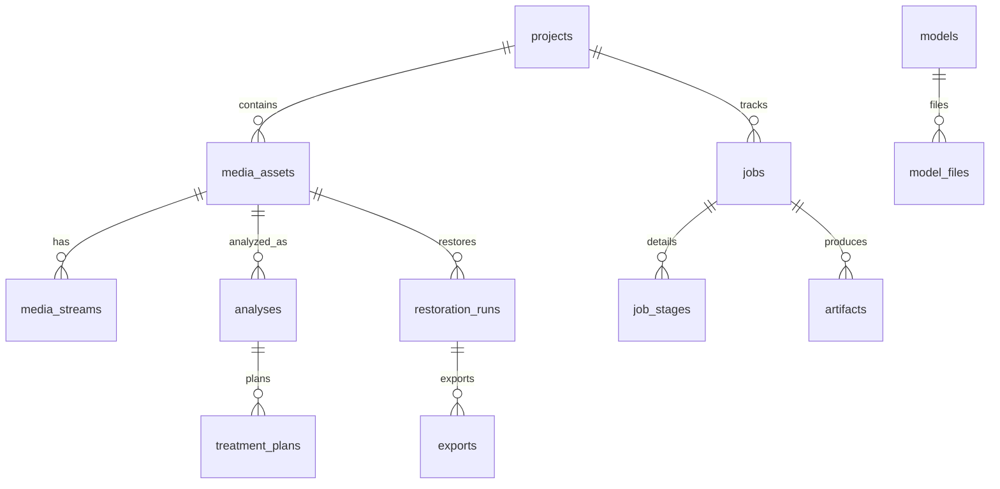

# Database Schema — AudioRestorer AI

**Status:** Approved planning document  
**Engine:** SQLite 3 via `better-sqlite3`  
**Mode:** WAL, foreign keys ON  
**Related:** [API_SPECIFICATION.md](API_SPECIFICATION.md), [SYSTEM_ARCHITECTURE.md](SYSTEM_ARCHITECTURE.md)

---

## 1. Design principles

1. SQLite is the **state of record** for projects, jobs, and metadata.  
2. Large binaries (audio, proxies, models) live on the **filesystem**; DB stores paths + hashes.  
3. Schema evolves via numbered migrations (`001_init.sql`, …).  
4. JSON columns store versioned analysis / plan / settings blobs (validated in app layer).  
5. Soft-delete optional for projects; hard-delete removes DB rows and may trash artifact dirs.

---

## 2. Entity relationship (logical)



---

## 3. Tables

### 3.1 `schema_migrations`

```sql
CREATE TABLE schema_migrations (
  version INTEGER PRIMARY KEY,
  applied_at TEXT NOT NULL
);
```

### 3.2 `projects`

```sql
CREATE TABLE projects (
  id TEXT PRIMARY KEY,
  name TEXT NOT NULL,
  root_path TEXT NOT NULL UNIQUE,
  status TEXT NOT NULL CHECK (status IN ('active', 'archived')) DEFAULT 'active',
  created_at TEXT NOT NULL,
  updated_at TEXT NOT NULL
);
```

### 3.3 `media_assets`

```sql
CREATE TABLE media_assets (
  id TEXT PRIMARY KEY,
  project_id TEXT NOT NULL REFERENCES projects(id) ON DELETE CASCADE,
  source_path TEXT NOT NULL,
  display_name TEXT NOT NULL,
  container TEXT NOT NULL,
  duration_sec REAL NOT NULL,
  size_bytes INTEGER NOT NULL,
  selected_audio_stream INTEGER NOT NULL DEFAULT 0,
  extracted_audio_path TEXT,
  probe_json_path TEXT,
  content_hash TEXT, -- optional hash of extracted audio
  created_at TEXT NOT NULL,
  UNIQUE (project_id, source_path)
);

CREATE INDEX idx_media_assets_project ON media_assets(project_id);
```

### 3.4 `media_streams`

```sql
CREATE TABLE media_streams (
  id TEXT PRIMARY KEY,
  media_id TEXT NOT NULL REFERENCES media_assets(id) ON DELETE CASCADE,
  stream_index INTEGER NOT NULL,
  codec_type TEXT NOT NULL,
  codec_name TEXT NOT NULL,
  duration_sec REAL,
  sample_rate INTEGER,
  channels INTEGER,
  channel_layout TEXT,
  bit_rate INTEGER,
  width INTEGER,
  height INTEGER,
  avg_frame_rate TEXT,
  start_pts REAL,
  start_time_sec REAL,
  disposition_default INTEGER NOT NULL DEFAULT 0,
  tags_json TEXT,
  UNIQUE (media_id, stream_index)
);
```

### 3.5 `analyses`

```sql
CREATE TABLE analyses (
  id TEXT PRIMARY KEY,
  media_id TEXT NOT NULL REFERENCES media_assets(id) ON DELETE CASCADE,
  job_id TEXT REFERENCES jobs(id) ON DELETE SET NULL,
  schema_version TEXT NOT NULL,
  result_json TEXT NOT NULL, -- AnalysisResult
  result_path TEXT,          -- optional sidecar JSON file
  created_at TEXT NOT NULL
);

CREATE INDEX idx_analyses_media ON analyses(media_id);
```

### 3.6 `treatment_plans`

```sql
CREATE TABLE treatment_plans (
  id TEXT PRIMARY KEY,
  analysis_id TEXT NOT NULL REFERENCES analyses(id) ON DELETE CASCADE,
  schema_version TEXT NOT NULL,
  preset TEXT NOT NULL CHECK (preset IN ('natural', 'balanced', 'enhanced')),
  plan_json TEXT NOT NULL, -- TreatmentPlan
  created_at TEXT NOT NULL
);
```

### 3.7 `restoration_runs`

```sql
CREATE TABLE restoration_runs (
  id TEXT PRIMARY KEY,
  project_id TEXT NOT NULL REFERENCES projects(id) ON DELETE CASCADE,
  media_id TEXT NOT NULL REFERENCES media_assets(id) ON DELETE CASCADE,
  analysis_id TEXT NOT NULL REFERENCES analyses(id),
  plan_id TEXT REFERENCES treatment_plans(id),
  job_id TEXT REFERENCES jobs(id) ON DELETE SET NULL,
  mode TEXT NOT NULL CHECK (mode IN ('preview', 'full')),
  settings_json TEXT NOT NULL, -- RestorationSettings snapshot
  settings_hash TEXT NOT NULL,
  output_artifact_id TEXT REFERENCES artifacts(id),
  report_json TEXT, -- quality report / warnings
  created_at TEXT NOT NULL
);

CREATE INDEX idx_restoration_runs_media ON restoration_runs(media_id);
```

### 3.8 `jobs`

```sql
CREATE TABLE jobs (
  id TEXT PRIMARY KEY,
  project_id TEXT NOT NULL REFERENCES projects(id) ON DELETE CASCADE,
  kind TEXT NOT NULL CHECK (kind IN (
    'analyze', 'preview', 'restore', 'export', 'model_install', 'extract'
  )),
  state TEXT NOT NULL CHECK (state IN (
    'queued', 'preparing', 'running', 'validating',
    'completed', 'failed', 'cancelled', 'interrupted'
  )),
  progress REAL NOT NULL DEFAULT 0 CHECK (progress >= 0 AND progress <= 1),
  result_ref TEXT,
  error_json TEXT,
  payload_json TEXT, -- request snapshot for resume
  created_at TEXT NOT NULL,
  updated_at TEXT NOT NULL,
  started_at TEXT,
  finished_at TEXT
);

CREATE INDEX idx_jobs_project_state ON jobs(project_id, state);
```

### 3.9 `job_stages`

```sql
CREATE TABLE job_stages (
  id TEXT PRIMARY KEY,
  job_id TEXT NOT NULL REFERENCES jobs(id) ON DELETE CASCADE,
  stage_id TEXT NOT NULL,
  state TEXT NOT NULL,
  progress REAL NOT NULL DEFAULT 0,
  message TEXT,
  artifact_id TEXT REFERENCES artifacts(id),
  started_at TEXT,
  finished_at TEXT,
  UNIQUE (job_id, stage_id)
);
```

### 3.10 `artifacts`

```sql
CREATE TABLE artifacts (
  id TEXT PRIMARY KEY,
  project_id TEXT NOT NULL REFERENCES projects(id) ON DELETE CASCADE,
  media_id TEXT REFERENCES media_assets(id) ON DELETE SET NULL,
  kind TEXT NOT NULL CHECK (kind IN (
    'extracted_audio', 'stage_audio', 'preview_audio', 'restored_audio',
    'video_proxy', 'analysis_json', 'quality_report', 'other'
  )),
  path TEXT NOT NULL,
  content_hash TEXT,
  stage_id TEXT,
  params_hash TEXT,
  bytes INTEGER,
  created_at TEXT NOT NULL,
  UNIQUE (project_id, content_hash, stage_id, params_hash)
);

CREATE INDEX idx_artifacts_project ON artifacts(project_id);
```

### 3.11 `exports`

```sql
CREATE TABLE exports (
  id TEXT PRIMARY KEY,
  project_id TEXT NOT NULL REFERENCES projects(id) ON DELETE CASCADE,
  media_id TEXT NOT NULL REFERENCES media_assets(id),
  restoration_run_id TEXT NOT NULL REFERENCES restoration_runs(id),
  job_id TEXT REFERENCES jobs(id) ON DELETE SET NULL,
  output_path TEXT NOT NULL,
  mode TEXT NOT NULL CHECK (mode IN ('video_remux', 'audio_only')),
  container TEXT NOT NULL,
  audio_codec TEXT NOT NULL,
  video_copied INTEGER NOT NULL DEFAULT 0,
  duration_sec REAL NOT NULL,
  sample_count_ok INTEGER NOT NULL DEFAULT 0,
  loudness_json TEXT,
  warnings_json TEXT,
  created_at TEXT NOT NULL
);
```

### 3.12 `models`

```sql
CREATE TABLE models (
  id TEXT PRIMARY KEY, -- e.g. deepfilternet3
  name TEXT NOT NULL,
  phase TEXT NOT NULL CHECK (phase IN ('mvp', 'v2', 'v3')),
  optional INTEGER NOT NULL DEFAULT 0,
  license_notice TEXT,
  state TEXT NOT NULL CHECK (state IN (
    'notInstalled', 'downloading', 'verifying', 'installed', 'error'
  )),
  version TEXT,
  installed_at TEXT,
  error_message TEXT
);
```

### 3.13 `model_files`

```sql
CREATE TABLE model_files (
  id TEXT PRIMARY KEY,
  model_id TEXT NOT NULL REFERENCES models(id) ON DELETE CASCADE,
  relative_path TEXT NOT NULL,
  sha256 TEXT NOT NULL,
  size_bytes INTEGER NOT NULL,
  source_url TEXT,
  UNIQUE (model_id, relative_path)
);
```

### 3.14 `settings`

```sql
CREATE TABLE settings (
  key TEXT PRIMARY KEY,
  value_json TEXT NOT NULL,
  updated_at TEXT NOT NULL
);
```

Singleton logical `AppSettings` stored as one row `key = 'app'` or flattened keys.

---

## 4. Migrations strategy

1. On startup, open DB and apply pending migrations in a transaction.  
2. Never edit applied migration files; add new numbered files.  
3. Backup DB before destructive migrations in production builds.  
4. `PRAGMA foreign_keys = ON;` every connection.  
5. `PRAGMA journal_mode = WAL;`  
6. `PRAGMA busy_timeout = 5000;`

---

## 5. Filesystem layout

```
%USERPROFILE%/AudioRestorer/
  settings.sqlite                 # or per-app data dir
  runtime/                        # uv + Python 3.12 env
  models/
    manifest.json
    silero_vad/...
    deepfilternet3/...
  logs/

{project_root}/
  project.sqlite                  # optional: per-project DB (alt: single global DB)
  originals/                      # optional copies or sidecar refs only
  .audiorestorer/
    probe/{media_id}.json
    extracted/{media_id}.wav
    analysis/{analysis_id}.json
    stages/{run_id}/{stage_id}_{hash}.wav
    preview/{run_id}/
    restored/{run_id}.wav
    proxies/{media_id}_h264.mp4
    exports/                      # optional staging before user path
    tmp/
```

**Recommended MVP:** one **global** SQLite in app data + project directories for artifacts. Project `root_path` points at the folder containing `.audiorestorer/`.

### Immutability

- `source_path` originals are never opened for write.  
- Optional: copy-on-import into `originals/` for portability (setting).  
- Stage outputs are write-once; replace = new hash/path.

### Cleanup

- `tmp/` swept on start/exit.  
- Failed jobs may retain stages until user clears cache.  
- Uninstall does not delete user projects unless chosen.

---

## 6. Resume / crash recovery

1. Jobs left in `running`/`preparing` at startup → mark `interrupted`.  
2. User can retry; JobManager reads `payload_json` + last completed `job_stages.artifact_id`.  
3. Engine skips stages when artifact hash matches expected `params_hash`.

---

## 7. Related documents

- [API_SPECIFICATION.md](API_SPECIFICATION.md)
- [SYSTEM_ARCHITECTURE.md](SYSTEM_ARCHITECTURE.md)
- [DEVELOPMENT_ROADMAP.md](DEVELOPMENT_ROADMAP.md)
