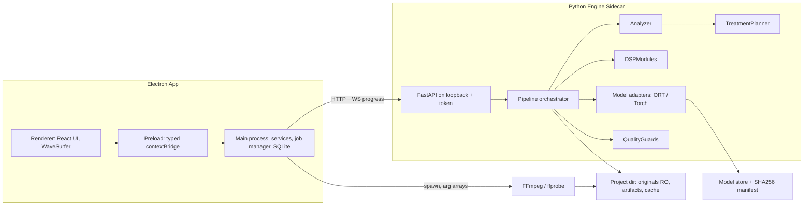
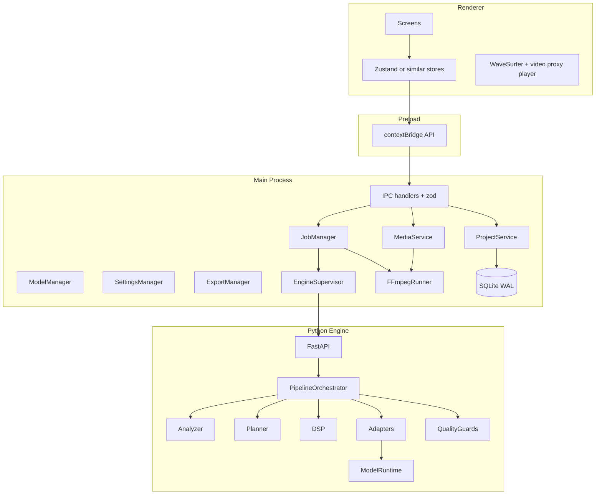
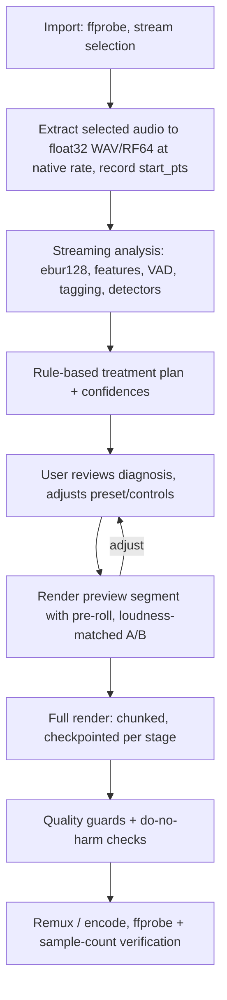
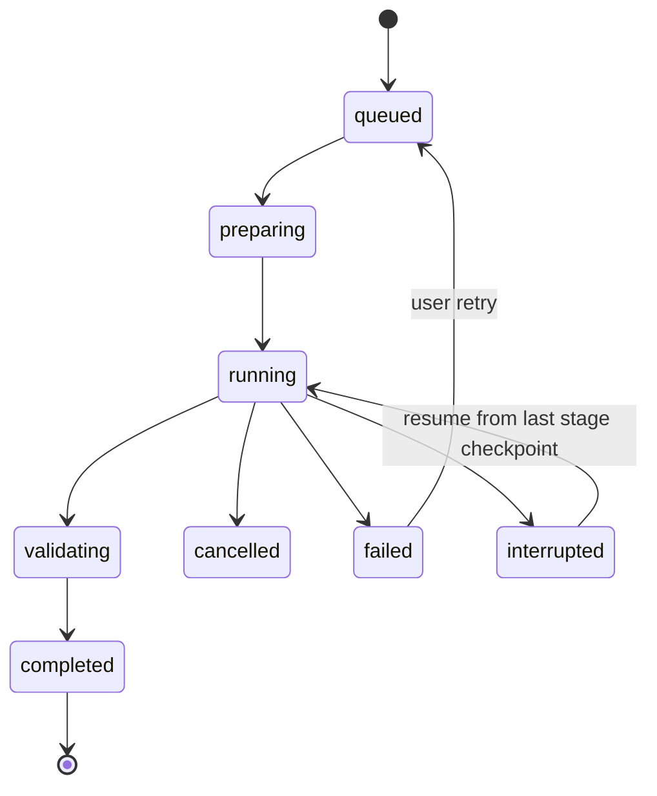
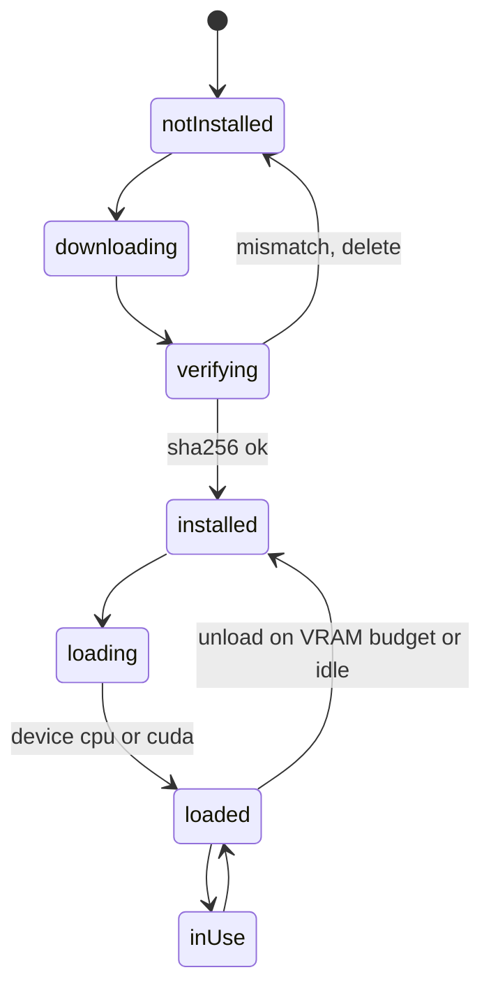
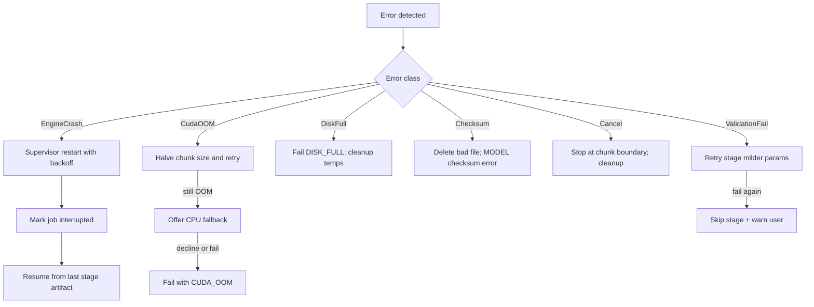

# System Architecture — AudioRestorer AI

**Status:** Approved planning document  
**Related:** [PRODUCT_REQUIREMENTS.md](PRODUCT_REQUIREMENTS.md), [API_SPECIFICATION.md](API_SPECIFICATION.md), [AUDIO_PIPELINE.md](AUDIO_PIPELINE.md)

---

## 1. Goals and constraints

| Goal | Constraint |
|------|------------|
| Offline restoration quality | No mandatory cloud |
| Windows 10/11 desktop | Electron + Chromium codecs gaps |
| GPU on RTX 3070 8 GB | Sequential inference, VRAM budget |
| Large files | Streaming, RF64, chunked OLA |
| Maintainability | Clear Node vs Python boundary |
| GPL-3.0-or-later portfolio OSS | Pedalboard/FFmpeg GPL OK; model weights separate |

---

## 2. Stack evaluation and decisions

### 2.1 Desktop shell

| Option | Pros | Cons | Decision |
|--------|------|------|----------|
| **Electron + React + Vite + Tailwind + WaveSurfer** | Mature media APIs, Chromium A/V, rich ecosystem, electron-vite DX | Large binary; security diligence required | **Selected** |
| Tauri 2 | Smaller binary, Rust security story | WebView2 media inconsistencies; still needs Python sidecar | Rejected for MVP |
| Qt / native | Native media | UI velocity lower for hybrid AI product | Rejected |
| Pure web + local server | Simple | Packaging and UX weaker | Rejected |

**Chromium codec gap:** MKV, AVI, HEVC, AC3 are unreliable or unsupported. Mitigate with **preview proxies** (H.264 low-res video + original/restored audio as WAV/Opus segments).

### 2.2 Application backend

| Option | Pros | Cons | Decision |
|--------|------|------|----------|
| **Electron main + SQLite + typed IPC** | One fewer process; state of record colocated with UI lifecycle | Main must stay lean | **Selected** |
| Separate Node HTTP API | Clear HTTP contracts | Extra process, port mgmt, attack surface | Rejected |
| Pure Python UI | Single language | Weak video UX on Windows | Rejected |

Services in main process: Project, Media, Job, Model, Settings, Export, EngineSupervisor, FFmpegRunner.

### 2.3 IPC / engine bridge

| Option | Pros | Cons | Decision |
|--------|------|------|----------|
| **FastAPI sidecar on 127.0.0.1 + bearer token + WebSocket progress** | OpenAPI, curl/CLI testability, typed clients | HTTP overhead | **Selected** |
| stdio JSON-RPC | No port | Harder streaming/debug; framing bugs | Fallback if needed |
| gRPC | Efficient | Heavier Windows packaging | Deferred |

### 2.4 AI / DSP runtime

| Component | Choice | Notes |
|-----------|--------|-------|
| Language | Python 3.12 | Matches librosa/numpy/scipy baselines (verified 2026-11-23) |
| API | FastAPI + Pydantic v2 | Contract source of truth |
| Arrays | NumPy, SciPy | Streaming STFT / filters |
| DSP FX | Pedalboard (GPL-3.0) | Compatible with project license |
| Loudness | pyloudnorm + FFmpeg ebur128 (authoritative for integrate) | |
| Heavy ML | PyTorch CUDA wheels | Bundle CUDA runtime; no system nvcc required |
| Light ML | ONNX Runtime **CPU** | Avoid onnxruntime-gpu DLL hell on Windows for MVP |
| Packaging env | `uv` + python-build-standalone | Lockfile + hashes; first-run provision to `%LOCALAPPDATA%` |
| Bundle alt | PyInstaller | **Rejected** — fragile with torch/CUDA, multi-GB opaque blobs |

### 2.5 Media

| Component | Owner | Notes |
|-----------|-------|-------|
| FFmpeg / ffprobe | **Node (main)** | Arg arrays only; never shell |
| Audio I/O in engine | soundfile / RF64 WAV | Float32 interchange |
| Remux / encode | Node | Video stream-copy by default |

### 2.6 Storage

| Store | Use |
|-------|-----|
| SQLite (better-sqlite3, WAL) | Projects, jobs, metadata, settings |
| Filesystem | Originals (RO), artifacts, caches, model store |
| Model manifest | SHA-256 pinned revisions |

---

## 3. Responsibility boundary

```
┌─────────────────────────────────────────────────────────────┐
│ Electron main (TypeScript)                                  │
│  • Project / job / settings state (SQLite)                  │
│  • FFmpeg: probe, extract, proxy, remux, export validate    │
│  • Engine supervisor (spawn, health, restart, token)        │
│  • IPC to renderer (zod-validated)                          │
└───────────────────────────┬─────────────────────────────────┘
                            │ HTTP + WS (loopback + token)
┌───────────────────────────▼─────────────────────────────────┐
│ Python engine (FastAPI)                                     │
│  • Audio-in / audio-out only (WAV/RF64 float32)             │
│  • Analyze, plan, render stages                             │
│  • Model adapters (ORT / Torch), DSP, quality guards        │
│  • Idempotent stage artifacts under project paths           │
└─────────────────────────────────────────────────────────────┘
```

**Rule:** Python never remuxes video. Node never runs PyTorch.

---

## 4. Logical components

### A. Desktop UI (renderer)

- Project management, media import, video player (proxy), waveform (WaveSurfer.js)
- AI diagnosis dashboard, restoration controls, A/B comparison, export center
- Model management, application settings

### B. Application backend (main)

- ProjectService, MediaService, JobManager, ModelManager, SettingsManager, ExportManager
- FileManagement, EngineSupervisor, FFmpegRunner

### C. AI engine

- Audio extraction handoff (receives paths), preprocessing, feature extraction
- Classification, degradation detection, treatment planner
- Model orchestration, AI restoration, DSP processing, quality validation

### D. Media engine (Node + FFmpeg)

- Integration, extraction, A/V sync, remuxing, encoding, export validation

---

## 5. Architecture diagrams

### 5.1 High-level architecture



### 5.2 Component architecture



### 5.3 Processing pipeline



### 5.4 Job lifecycle



### 5.5 Model inference lifecycle



### 5.6 Error handling and recovery



---

## 6. Process model and packaging

### 6.1 Runtime processes

1. **Electron main**
2. **Electron renderer** (sandboxed)
3. **Python engine** (uvicorn/FastAPI), supervised
4. **Short-lived FFmpeg** children

Optional later: isolated Python worker subprocess for incompatible model envs (AudioSR V3).

### 6.2 Engine supervision

- Spawn with `uv run` against provisioned env.
- Bind `127.0.0.1:0` (ephemeral port); pass port via stdout handshake or port file.
- Generate random bearer token per launch; inject via env.
- Health poll `GET /v1/health`.
- Restart with exponential backoff; max N; then surface UI error.
- On app quit: cancel jobs, graceful shutdown, force-kill timeout, temp sweep.

### 6.3 First-run provisioning

Installer ships: Electron app, `uv`, pinned FFmpeg binaries (+ checksums), model **manifest** (not all weights).

On first launch:

1. Install Python 3.12 via python-build-standalone into `%LOCALAPPDATA%\AudioRestorer\runtime`.
2. `uv sync` from locked `pyproject` / lockfile with hashes.
3. Offer **CUDA** vs **CPU** torch variant based on `nvidia-smi` detection.
4. Download MVP models with SHA-256 verify.

### 6.4 GPU / performance strategy

| Concern | Strategy |
|---------|----------|
| Sequential heavy models | Single GPU worker queue |
| VRAM | Explicit budget; unload when idle or before next heavy model |
| Chunking | ~10 s chunks with raised-cosine OLA; Demucs ≤ 7.8 s segments |
| Caching | Content-addressed stage artifacts |
| Progress | Stage % + chunk index over WebSocket |
| Cancellation | Cooperative at chunk boundaries (≤ 2 s) |
| Benchmarks | Measure RTF on reference machine; do not ship unverified speed claims |

Reference machine: i7-14700F, RTX 3070 8 GB, 32 GB RAM, NVMe, Windows 11, driver 610.x.

---

## 7. Contracts and typing

- **Engine:** Pydantic v2 models → OpenAPI → `openapi-typescript` → `packages/contracts`.
- **Node domain:** zod schemas in `packages/contracts` (projects, jobs, exports).
- Version fields on AnalysisResult, TreatmentPlan, RestorationSettings.

---

## 8. Security and reliability

### 8.1 Electron hardening

- `contextIsolation: true`, `sandbox: true`, `nodeIntegration: false`.
- Strict CSP (no remote script).
- Disable navigation to unexpected origins.
- Custom `media://` (or `audiorestorer://`) protocol restricted to allowlisted project directories.
- No `shell.openExternal` without allowlist.

### 8.2 IPC and engine

- All IPC payloads validated with zod.
- Engine only on loopback; Authorization bearer token required.
- CORS disabled / not needed (main process client only).

### 8.3 Filesystem

- Canonicalize paths; reject escapes outside project/root allowlists.
- Spawn FFmpeg/Python with argument arrays (never `shell: true`).
- Temp directories under project or app temp; sweep on start/exit.
- Originals marked read-only at OS level when feasible.

### 8.4 Supply chain

- Pin npm and Python deps with lockfiles and hashes where supported.
- Model downloads: URL + revision + SHA-256; mismatch deletes file.
- Third-party license bill of materials; FFmpeg GPL source offer.

### 8.5 Privacy and logging

- Structured logs: job ids, stages, metrics — **no PCM / no spectrogram dumps by default**.
- Optional path redaction.
- Crash recovery via SQLite job rows + stage artifacts.

### 8.6 Reliability

- WAL SQLite; migrations.
- Job persistence across restarts.
- Stage checkpoints for resume.
- Disk preflight: estimate temp space ≈ `duration × sr × channels × 4 × retained_stages`.

---

## 9. Repository structure (target)

```
audio-restoration/
  apps/desktop/                 # electron-vite
    src/main/
    src/preload/
    src/renderer/
  packages/contracts/           # zod + generated OpenAPI types
  engine/                       # uv Python 3.12 project
    src/audiorestorer_engine/
      api/
      io/
      analysis/
      planning/
      dsp/
      adapters/
      pipeline/
      quality/
    tests/
  eval/                         # harness + manifests (no media in git)
  packaging/                    # electron-builder, manifests, ffmpeg fetch
  docs/                         # this documentation set
```

Avoid unnecessary abstraction layers; adapters implement a small shared interface (`load`, `unload`, `process_chunk`, `latency_samples`).

---

## 10. Alternatives considered (summary)

| Decision | Alternative | Why not for MVP |
|----------|-------------|-----------------|
| Electron | Tauri | Media/WebView2 risk + still need sidecar |
| Main IPC services | Separate Node HTTP | Extra process |
| FastAPI | stdio RPC only | Worse debuggability |
| uv first-run env | PyInstaller | Torch/CUDA fragility |
| ORT CPU for small models | ORT-GPU | Windows CUDA DLL matching |
| Node owns FFmpeg | Python owns remux | Keeps engine audio-pure; sync validation in one place |

---

## 11. Open items for Phase 0

- Confirm DeepFilterNet3 ONNX export quality parity vs CLI on Windows.
- Confirm torch CUDA wheel for sm_86 + driver 610.
- Measure VRAM/RTF for MVP models on reference GPU.
- Finalize tagger (PANNs vs EfficientAT) after license check.
