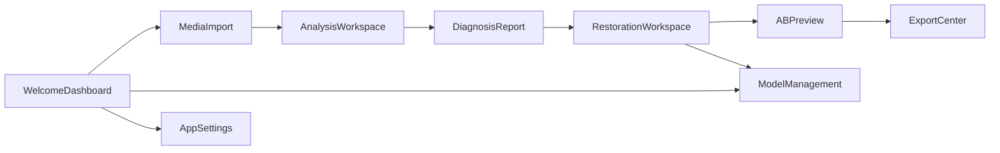

# UI/UX Specification — AudioRestorer AI

**Status:** Approved planning document  
**Stack:** React + TypeScript + Tailwind CSS + WaveSurfer.js (Electron renderer)  
**Related:** [PRODUCT_REQUIREMENTS.md](PRODUCT_REQUIREMENTS.md), [AUDIO_PIPELINE.md](AUDIO_PIPELINE.md)

---

## 1. UX principles

1. **Hybrid automation:** auto-analyze and recommend; never hide overrides.  
2. **Progressive disclosure:** beginners see presets + a few macros; advanced modules behind disclosure.  
3. **Honest AI:** communicate confidence, recoverability, and restoration vs reconstruction.  
4. **A/B truthfulness:** loudness-matched comparison by default.  
5. **Non-destructive:** originals always available; clear “working copy” language.  
6. **Offline clarity:** no account walls; model downloads are explicit and optional where licensed separately.

---

## 2. Information architecture

Primary guided path: **Import → Analyze → Diagnosis → Restore → A/B → Export**.

---

## 3. Screens

### 3.1 Welcome / project dashboard

**Purpose:** Open recent projects; create new; see engine/runtime status.

**Elements:**

- Recent projects grid (name, last opened, media count).  
- Create project / Open folder.  
- Status chips: Engine (running/stopped), Device (CUDA/CPU), Models ready.  
- First-run checklist if runtime not provisioned.

**Empty state:** Short value proposition + “Import media” CTA.

### 3.2 Media import

**Purpose:** Add files, show probe summary, select audio stream.

**Elements:**

- Drag-drop + file picker (multi-file queue for MVP sequential).  
- Probe card: container, duration, video codec, audio streams table.  
- Stream selector (radio on audio streams).  
- Warnings: unsupported codec, corrupt, VFR note, multichannel note.  
- Continue → extract audio job with progress.

### 3.3 Analysis workspace

**Purpose:** Run analysis; show waveform + video proxy; live progress.

**Elements:**

- Video proxy player (if video).  
- WaveSurfer waveform of extracted audio.  
- Analyze button / auto-start option.  
- Progress: stages (loudness, features, VAD, tagging, detectors).  
- Cancel.

### 3.4 Diagnosis report

**Purpose:** Explain what is wrong and what is recommended — with uncertainty.

**Elements:**

- Content mix summary (speech / music / mixed pie or bars).  
- Issue cards sorted by severity:
  - Title, short plain-language description.  
  - **Confidence** badge (High / Medium / Low).  
  - **Recoverability** chip (Recoverable / Partial / Not recoverable).  
  - Evidence expand (metrics).  
  - Region markers on waveform.  
- Recommended treatment list (enabled stages) with reasons.  
- CTA: Continue with Balanced (default) / change preset.

**Honesty copy examples:**

- “Clipping detected in ~4% of samples. Repair is **partial** — severe clips cannot be fully restored.”  
- “Speech noise reduction will run only on speech-dominant regions so music is not speech-processed.”  
- “This issue looks like missing high frequencies. EQ can help where signal remains; it will not invent unrecorded detail.”

### 3.5 Restoration workspace

**Purpose:** Adjust macros; optional advanced modules; start preview or full render.

**Layout:**

- Left: video + waveform.  
- Center/right: controls.  
- Bottom: job progress.

**Primary controls (always):**

- Preset: Natural | Balanced | Enhanced.  
- Restoration strength.

**Conditional macros** (show by content type — see §4):

- Speech clarity, Ambience preservation, Noise reduction.  
- Music enhancement, Bass balance, Treble recovery.  
- Stereo width, Loudness target.

**Advanced (collapsed):**

- Per-module toggles matching `StageId`.  
- Numeric params within safe bounds.  
- “Reset to recommended”.

**Actions:** Preview selection | Restore full file | Re-run diagnosis.

### 3.6 A/B preview

**Purpose:** Compare original vs restored fairly.

**Elements:**

- Transport synced to video proxy.  
- Toggle **A (Original)** / **B (Restored)** — sample-aligned, instant switch (keyboard: `A`/`B` or hold-to-flip).  
- **Loudness match** toggle (default ON) with explanation tooltip.  
- **Residual** mode: listen to removed signal (Original − Restored), gain-normalized carefully with warning about phase.  
- Dual spectrogram (original | restored).  
- Region scrubbers; loop selection.  
- “Back to adjust” / “Approve & export”.

### 3.7 Export center

**Purpose:** Choose outputs and verify.

**Elements:**

- Mode: Video with restored audio | Audio only.  
- Format / codec / bitrate.  
- Output path picker.  
- Options: open folder when done; (V2) keep original audio as secondary track.  
- Preflight: disk space, duration, estimated time (ranges, not false precision).  
- Post-export validation badges: sync OK, loudness, true peak.

### 3.8 Model management

**Purpose:** Install/remove models; show licenses.

**Elements:**

- Table: name, size, phase (MVP/V2/V3), state, license notice.  
- Install / Remove / Verify checksum.  
- Optional models (e.g. Demucs V2) require accept-notice modal quoting weight license uncertainty.  
- Disk usage summary.

### 3.9 Application settings

**Sections:**

- Device preference (Auto / CUDA / CPU).  
- Default preset & loudness target.  
- Paths: projects root, model store.  
- Privacy: redact paths in logs.  
- Advanced: max VRAM budget MB.  
- About: versions, FFmpeg path, third-party licenses link.

---

## 4. Controls by content type

| Control | Speech-dominant | Music-dominant | Mixed |
|---------|-----------------|----------------|-------|
| Strength | Yes | Yes | Yes |
| Speech clarity | Yes | Hidden | Yes |
| Ambience preservation | Yes | Yes | Yes |
| Noise reduction | Yes | Soft / yes | Yes |
| Music enhancement | Hidden | Yes | Yes |
| Bass balance | Optional | Yes | Yes |
| Treble recovery | Yes | Yes | Yes |
| Stereo width | Yes | Yes | Yes |
| Loudness target | Yes | Yes | Yes |
| De-ess (advanced) | Yes | Hidden | Soft |
| Separation remix (V2) | Hidden | Optional | Optional |

“Hidden” = not shown in basic UI; still visible under Advanced if power users expand all modules.

---

## 5. Progressive disclosure

**Level 0 — Beginner:** Preset + Strength + one-sentence diagnosis summary + Preview/Export.  
**Level 1 — Standard:** Macros in §4 + issue cards.  
**Level 2 — Advanced:** Per-stage toggles, params, residual spectrograms, model versions.

Remember last disclosure level per project.

---

## 6. Communicating uncertainty (anti-misleading AI)

| Mechanism | Behavior |
|-----------|----------|
| Confidence badges | High ≥0.75, Medium 0.4–0.75, Low &lt;0.4 |
| Recoverability | Explicit chip; Not recoverable issues never claim a fix |
| Reconstruction label | Generative BWE (V3) uses distinct purple “AI reconstruction” badge |
| Before/after claims | Prefer “recommended processing” over “fixed” / “perfect” |
| Disabled speech-on-music | Tooltip: “Speech enhancer blocked on music-dominant regions” |
| Guard skips | Toast + warning list: “Denoise skipped to avoid artifacts” |
| Empty miracle | No marketing copy about restoring unrecorded content |

---

## 7. Feedback, progress, errors

- Jobs use determinate progress when chunk counts known; else stage-based.  
- Cancel always available during analyze/restore/export.  
- Errors map `ApiError.code` to human text + optional “Retry” if `retryable`.  
- CUDA OOM: offer “Retry with smaller chunks” / “Switch to CPU”.  
- First-run provisioning: dedicated wizard with download sizes.

---

## 8. Accessibility & interaction

- Keyboard: space play/pause, A/B toggle, arrow seek.  
- Focus rings on controls; sufficient contrast (Tailwind palette).  
- Do not rely on color alone for severity (icons + text).  
- Waveform zoom/pan with trackpad and buttons.

---

## 9. Visual design notes (MVP)

- Dark-first UI (audio tools convention); light theme optional V2.  
- Density: comfortable, not DAW-cramped.  
- Tailwind design tokens for severity colors and reconstruction accent.  
- Avoid skeuomorphic VU overload; one clear loudness readout is enough.

---

## 10. Related documents

- [PRODUCT_REQUIREMENTS.md](PRODUCT_REQUIREMENTS.md)
- [API_SPECIFICATION.md](API_SPECIFICATION.md)
- [AUDIO_PIPELINE.md](AUDIO_PIPELINE.md)
